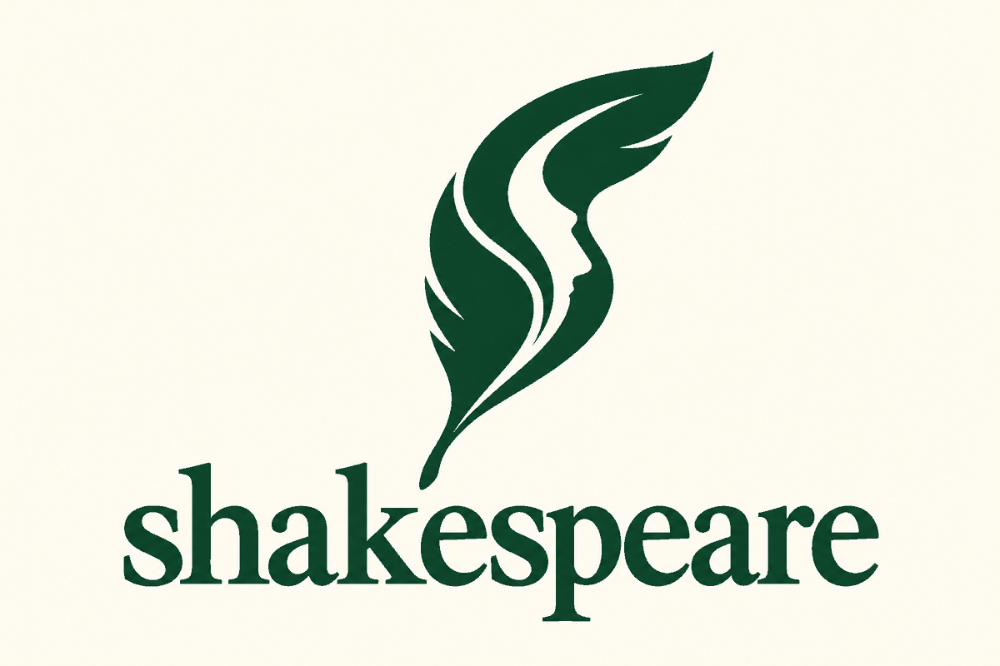

<p align="center">
  
</p>

<p align="center">
  A writing skill for Claude, ChatGPT and Codex. It drafts and edits prose so it reads like a capable person wrote it, following rules drawn from 66 research sources on how AI text differs from human writing and how detectors judge it.
</p>

<p align="center">
  <a href="https://tirelesscrew.com">Made by TirelessCrew</a> ·
  <a href="docs/SETUP.md">Setup</a> ·
  <a href="skills/shakespeare/references/pattern-catalog.md">Pattern catalog</a> ·
  <a href="skills/shakespeare/references/research-basis.md">Research basis</a>
</p>

---

Readers who see a lot of model output can usually tell. In Russell et al. (ACL 2025), five people who use ChatGPT heavily caught 299 of 300 AI-written articles between them, including articles that had been paraphrased or run through a "humanizer". They went by clusters of habits: "delve" next to "testament", sentences shaped like "it's not just X, it's Y", lists of three, quotes that all sound alike, a tidy uplifting last paragraph, and content any model would have produced on the topic.

Most of those habits are settled before the first sentence is written, in how the piece is planned. That's why a paraphrase or a "make it sound human" prompt leaves them in place. Shakespeare starts earlier. It works out the genre and the facts actually on hand, drafts from them, and then makes one pass for the patterns the research has measured. When it edits your writing, it changes as little as it can.

## What it does differently

- It won't invent quotes, statistics, anecdotes, outcomes or feelings. If your notes are thin, it works with what's there and leaves bracketed prompts for the details only you know.
- It picks the register before drafting. A group-chat message and a research abstract shouldn't come out in the same polished voice, and that voice is what chat models fall back on.
- In revision it fixes structure first (the angle, what's in, the order, the opening and the ending) and gets to word choice last.
- It leaves your fragments, odd word choices, complaints and jokes alone, and it won't turn "use" into "leverage".
- It watches for the tells that appear once the obvious ones are gone: runs of short, blunt sentences, and dialogue that's too neat.

## Install

**Claude.** Download `shakespeare.zip` from the [latest release](../../releases/latest) and upload it under **Customize → Skills → Upload a skill**. Code execution has to be on. Then ask something like *"Use Shakespeare to revise this, keeping my voice and facts."*

**ChatGPT.** Create a Project and paste [`chatgpt/Shakespeare-ChatGPT-Instructions.md`](chatgpt/Shakespeare-ChatGPT-Instructions.md) into its instructions.

**Codex and ChatGPT desktop.** The [`skills/shakespeare`](skills/shakespeare) folder is a standard skill (`$shakespeare` in Codex).

[docs/SETUP.md](docs/SETUP.md) has the details.

## The checker

[`pattern_check.py`](skills/shakespeare/scripts/pattern_check.py) needs nothing beyond the Python standard library. It counts surface patterns and shows where they are:

```
$ python3 skills/shakespeare/scripts/pattern_check.py draft.txt
Flags (check in context; none is proof of anything):
  - High density of overused vocabulary (10 hits).
  - Negative parallelism / 'not only…but also' present: state the positive claim.
  - Many trailing -ing clauses: split or cut.
  - Ending may recap or moralize: ultimately, journey, future
```

Read the output as a list of places to look. Human writing trips some of these flags too.

## Research

The rules draw on three sets of sources:

- 31 on detecting AI text (2019–2026), including GLTR, DetectGPT, Binoculars, Ghostbuster, RAID, MAGE, the watermarking papers, the study showing detectors are biased against non-native writers, and Russell et al.
- 17 newer studies of LLM style (2024–2026): professional writers' edits of model prose (Chakrabarty et al.), grammatical differences between LLM and human writing (Reinhart et al., *PNAS*), narrative patterns in AI fiction (StoryScope), measurements of "slop", Antislop, excess vocabulary in scientific abstracts, and the flattening of individual voice (*Nature Human Behaviour*).
- 18 on how current detectors work (2024–2026): technical reports from Pangram, GPTZero and Turnitin, independent benchmarks (NBER, Epoch AI), and studies of humanizers, AI-polished text and human post-editing (ACL, NAACL, NeurIPS, ICLR).

[research-basis.md](skills/shakespeare/references/research-basis.md) links each rule to its sources and grades the evidence. The [research folder](research) has links to every paper. The PDFs aren't in the repo, but a script downloads them.

## Limits

Shakespeare is an editing method. It can't prove who wrote something or hide it, and it doesn't promise any detector score. Current detectors estimate how much of a text a model produced, so a page Claude drafted will usually score as AI however well it's edited. What lowers that honestly is your own material and your own edits; [detectors.md](skills/shakespeare/references/detectors.md) explains why. Two findings from the research matter here: structural and statistical signals survive surface edits, and detectors misfire on plain human writing, especially from non-native writers. If you're required to disclose AI use, disclose it.

## License and credits

MIT, see [LICENSE](LICENSE).

Made by Iman at [TirelessCrew](https://tirelesscrew.com), a platform for building and running AI agents. The research guide and the extraction notes were written with AI help, and every source is linked so you can check them.

Not affiliated with any other product called Shakespeare.
